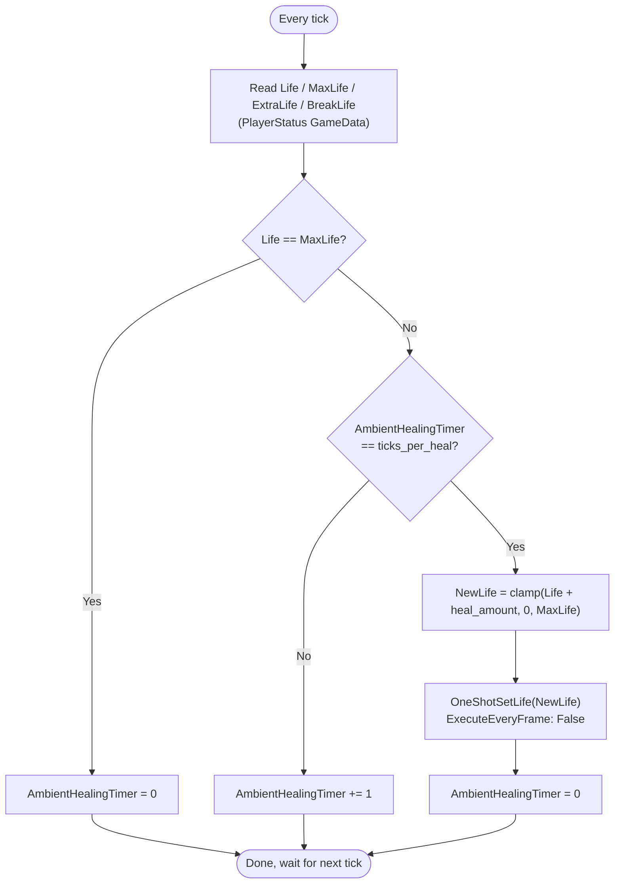

# Ambient Healing (Fixed for 1.4.3)

A rebuild of the "Ambient Healing (Full Heart per 1 Minute)" GameBanana mod
so it works with TotK v1.4.3 on the static recompilation (`totk-pc-recomp`).

**This repository contains no game files, assets, or data extracted from
the game.** It's build tooling only: a script that reads a 1.4.3 romfs
dump provided from your own legally obtained copy of the game and
writes out a small mod archive.

## Quick start

```sh
python -m venv venv
venv/bin/pip install -r tools/requirements.txt
venv/bin/python tools/build_mod.py --romfs /path/to/your/TotK-1.4.3/romfs
```

This writes a mod to `./output/Ambient Healing v1.4.3/` (or wherever
`--out` points) - copy its `romfs/` folder into your recomp's `mods/`
directory like any other RomFS mod.

## Why the original mod didn't just work as-is

The original mod shipped a complete replacement of
`romfs/Pack/Actor/Player.pack.zs`, built against an older game version
(before the 1.4.0 "Ounce Edition" update). Replacing the *entire* archive
meant every other file bundled inside it - around 330 unrelated AI/param
files - also reverted to that older version. It also shipped a
hand-edited `GameData/GameDataList.Product.110.byml.zs`, registering a
persistent save-data field (`AmbientHealingTimer`) against an incompatible
schema revision for an older game version.

Comparing the old mod's `Player.event.root.ainb` against 1.4.3's directly
confirmed the mod's *logic itself* never needed to change at all - every
node has an identical GUID and identical content between versions. The
only difference is that Nintendo added nodes elsewhere in the file between
versions, shifting every index number by a small constant - which is
exactly the kind of low-level detail that makes a straight file-replace
mod "version-locked" even when nothing meaningful changed.

## How it actually works

The mod adds exactly two things to `Player.pack.zs`, and changes nothing
else:

1. A brand-new file, `AI/Player.NoCalcSkipUtility.root.ainb` - a small,
   self-contained AI tree (not based on any stock file, since none exists
   for the Player actor). This naming matches a real, used engine
   convention: "NoCalcSkip" utility trees are meant for background logic
   that must keep ticking even when the engine's normal "skip AI
   calculations when nothing relevant is happening" optimization would
   otherwise apply - exactly suited for ambient passive healing, and
   completely independent of the game's main per-frame input-processing
   tree.
2. `Component/BSAParam/Player.game__component__BSAParam.bgyml`'s
   `NoCalcSkipUtilityAin` field (present, but empty, in the stock file) is
   patched to point at that new file. Without this, the engine never
   discovers or runs it - the file can exist in the pack and simply be
   ignored.

Tree logic (see `tools/build_mod.py`'s `build_nocalcskip_ainb`):
```
if Life == MaxLife:
    AmbientHealingTimer = 0
elif AmbientHealingTimer == ticks_per_heal:
    Life = clamp(Life + heal_amount, 0, MaxLife)
    AmbientHealingTimer = 0
else:
    AmbientHealingTimer += 1
```



Each tick takes **exactly one** of the three paths (full / waiting / healing)
- the timer only ever increments on the "waiting" path, and only ever
resets on the other two, so there's no double-counting or redundant
writes. `OneShotSetLife` is reached on only 1 tick out of every
`ticks_per_heal` (never called unconditionally every frame), which is
what avoids the invincibility side effect described below. The explicit
`clamp` before writing `Life` guards against ever requesting a value
above `MaxLife` or below 0, even if `heal_amount` doesn't evenly divide
the amount of health actually missing.

`OneShotSetLife` is called with `ExecuteEveryFrame: False` (matching the
original mod) - calling it every frame unconditionally, even with a
"no-op" value, was tried first and reliably caused a persistent
invincibility side effect (confirmed: hearts showed a white glow/outline
and stayed there; damage stopped registering). Firing it only on the
exact tick the heal happens avoids that entirely.

### One deliberate deviation from the original mod

The original stores its timer in a custom persistent **GameData** field
(`AmbientHealingTimer`), requiring an edit to
`GameData/GameDataList.Product.*.byml.zs`. This build instead uses an AINB
**Blackboard** S32 variable scoped to the new file - proven reliable in
isolated testing (a modulo-counter "sawtooth" diagnostic matched
predictions exactly), and much lower-risk than hand-patching a save-data
schema file. The only practical difference: the GameData version would
persist the timer's exact phase across a full game restart; the
Blackboard version resets to 0 whenever `Player.brain.root.ainb`'s
`NoCalcSkipUtilityAin` tree is freshly instantiated (effectively, each
time you load the game) - the heal cadence itself is unaffected either
way.

## Configuring the timer

```sh
venv/bin/python tools/build_mod.py --romfs /path/to/your/TotK-1.4.3/romfs \
    --seconds 60 --heal-amount 1
```

- `--romfs PATH` - path to your own 1.4.3 romfs dump. Required; see
  "No bundled game content" below.
- `--out PATH` - output mod directory (default:
  `./output/Ambient Healing v1.4.3`, relative to the current directory).
- `--seconds N` - real-time seconds between heal pulses (default: 60).
  This is real-world wall-clock time passed while playing, not TotK's
  accelerated in-game day/night clock (there's no AI node in this tree
  reading that clock - only the tick counter we drive ourselves).
- `--heal-amount N` - life units (quarter-hearts) healed per pulse
  (default: 1; 4 = one full heart, matching the original mod's default).
- `--ticks-per-second N` - AI tree tick rate used to convert `--seconds`
  into a tick count (default: 30). This comes directly from the original
  mod: its "Full Heart per 1 Minute" variant compares its timer against a
  literal constant of 1800 ticks, and since the author named it "per 1
  Minute" (60 real-world seconds), that implies 1800/60 = 30 ticks/second.
  Adjust this if the real cadence observed in-game doesn't match
  expectations.